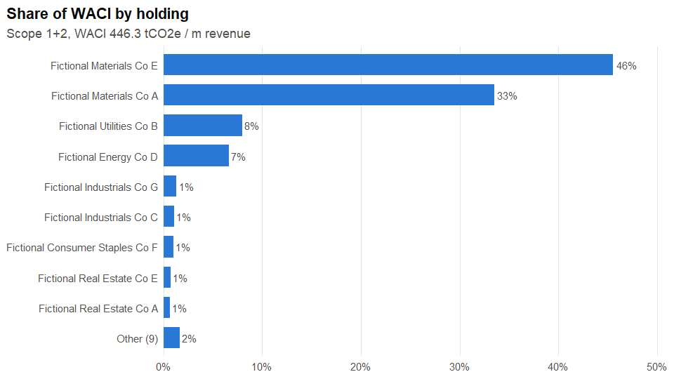
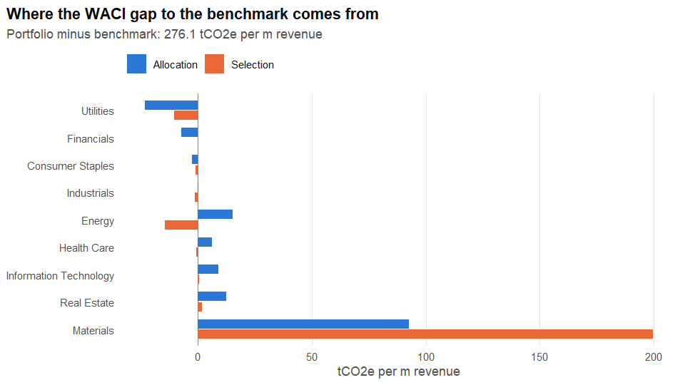
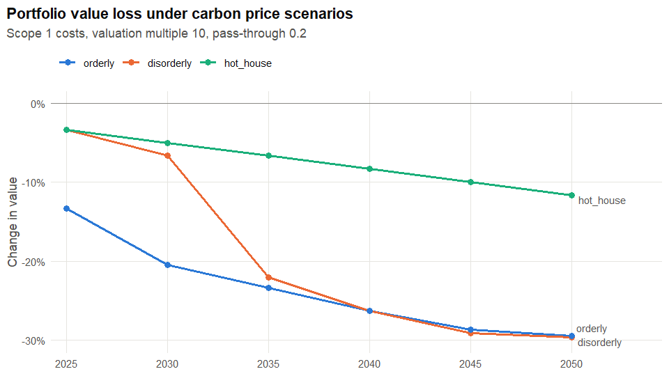

<!-- README.md is generated from README.Rmd. Please edit that file -->

# ecoPortfolio

<!-- badges: start -->

[](https://github.com/adebayomoses/ecoPortfolio/actions/workflows/R-CMD-check.yaml)
[](https://app.codecov.io/gh/adebayomoses/ecoPortfolio)
<!-- badges: end -->

Climate risk metrics for equity portfolios in R.

`ecoPortfolio` provides:

- **Disclosure metrics** recommended by TCFD and ISSB: weighted average
  carbon intensity (`waci()`), PCAF-style financed emissions
  (`financed_emissions()`) and carbon footprint (`carbon_footprint()`),
  always reported with data coverage.
- **Attribution.** Find the holdings and sectors driving exposure
  (`waci_contribution()`), and split the gap to a benchmark into sector
  allocation and stock selection (`waci_attribution()`).
- **Carbon price stress tests.** Earnings at risk and valuation shocks
  under scenario price paths (`carbon_stress_test()`).
- **Open data.** Asset-level emissions and owners from the Climate TRACE
  API (`ct_assets()`, `owner_emissions()`), matched to holdings by
  normalised name (`match_holdings()`).
- **Charts.** TCFD/ISSB-aligned disclosure plots built with ggplot2
  (`plot_contribution()`, `plot_sector_intensity()`,
  `plot_attribution()`, `plot_stress()`).

## Installation

``` r
# install.packages("remotes")
remotes::install_github("adebayomoses/ecoPortfolio")
```

## Example

The package ships a **fictional** 20-holding portfolio and a 60-company
benchmark.

``` r
library(ecoPortfolio)

p <- climate_portfolio(example_portfolio)
b <- climate_portfolio(example_benchmark, portfolio_value = 500)

climate_metrics(p)
#>               metric    scopes       value               unit  coverage
#> 1               waci Scope 1+2    446.2981  tCO2e / m revenue 0.8960842
#> 2 financed_emissions Scope 1+2 152711.8739              tCO2e 0.8960842
#> 3   carbon_footprint Scope 1+2    340.8291 tCO2e / m invested 0.8960842
```

A few holdings usually account for most of the carbon exposure:

``` r
plot_contribution(p)
```



The portfolio holds fewer utilities and energy companies than its
benchmark, yet its WACI is higher. Attribution shows why: the materials
companies it picked are far more carbon-intensive than the sector
average.

``` r
compare_benchmark(p, b)
#>               metric    scopes               unit   portfolio   benchmark
#> 1               waci Scope 1+2  tCO2e / m revenue    446.2981   170.16371
#> 2 financed_emissions Scope 1+2              tCO2e 152711.8739 41527.38666
#> 3   carbon_footprint Scope 1+2 tCO2e / m invested    340.8291    83.05477
#>    difference relative coverage_portfolio coverage_benchmark
#> 1    276.1343 1.622757          0.8960842                  1
#> 2 111184.4872 2.677377          0.8960842                  1
#> 3    257.7743 3.103666          0.8960842                  1
plot_attribution(waci_attribution(p, b))
```



Under carbon price scenarios, the portfolio loses value as prices rise:

``` r
st <- carbon_stress_test(p, pass_through = 0.2)
plot_stress(st)
```



See `vignette("ecoPortfolio")` for the full workflow, including Climate
TRACE data.

## Caveats

- The example portfolio, benchmark and `carbon_price_paths` are
  **synthetic and illustrative**. For real stress tests, use official
  NGFS scenario paths from <https://data.ece.iiasa.ac.at/ngfs/>.
- The stress test is a transparent first-order model (cost × multiple,
  capped at market value). It is meant for teaching and screening, not
  as a forecast.
- Climate TRACE emissions are independent physical estimates for
  individual assets. Owners are often subsidiaries, and ownership shares
  are not published (equal shares are assumed). Check matches before
  relying on them.
- The plots support disclosure aligned with TCFD and ISSB
  recommendations. They do not by themselves make a report compliant
  with any regulation.

## Data credits

Climate TRACE data are available under CC BY 4.0:
<https://climatetrace.org>.
